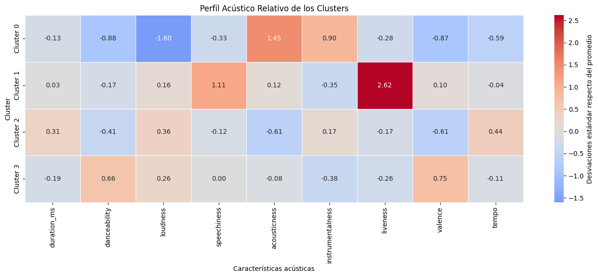
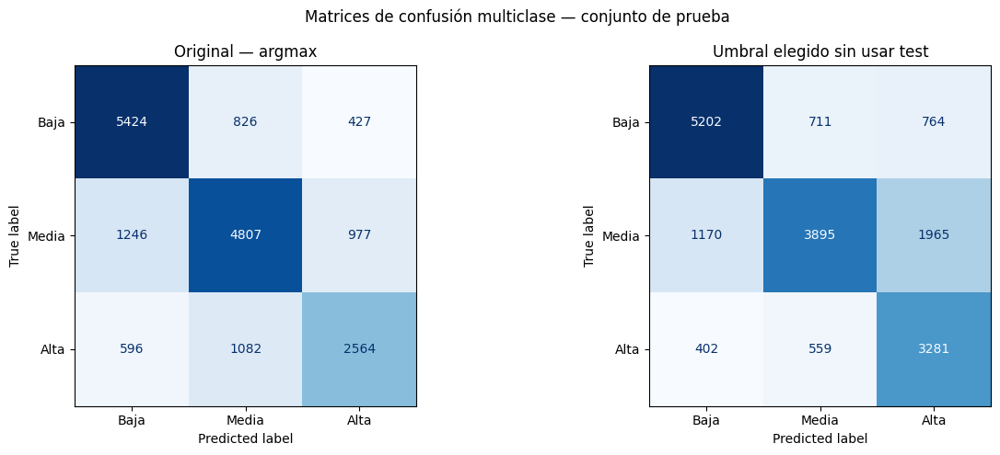
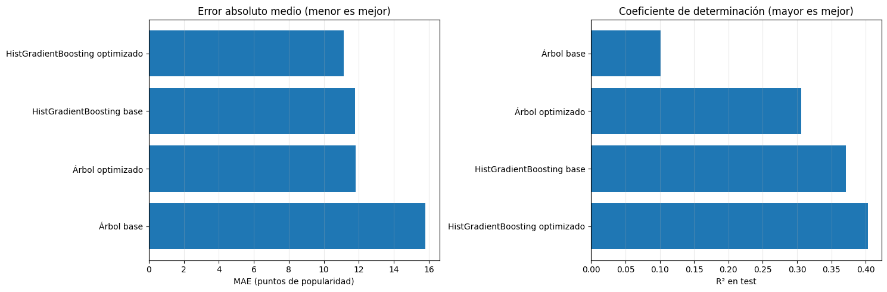
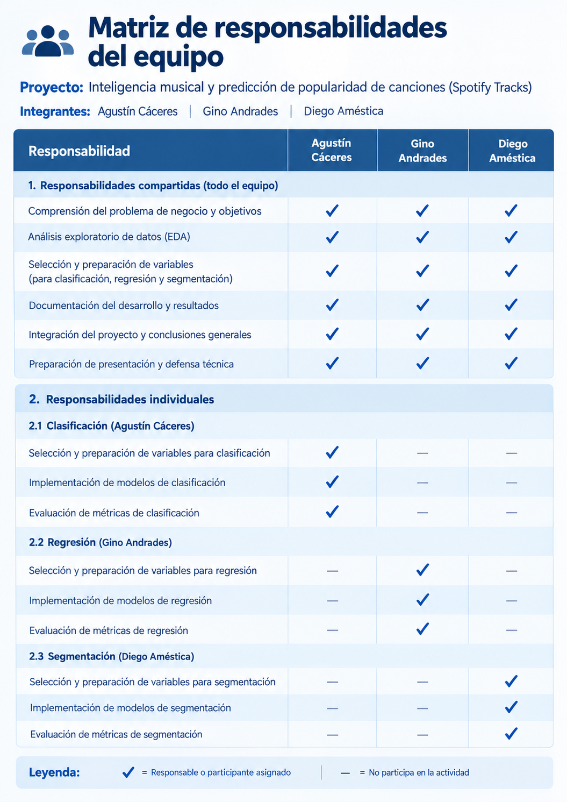

# Inteligencia musical y predicción de popularidad de canciones

**Spotify Tracks · Proyecto de Machine Learning · Duoc UC · 2026**

[Repositorio](https://github.com/Zevk4/Ev3-ml-spotify) · [Notebooks](notebooks/) · [Resultados](data/) · [Informe técnico](reports/Informe_Machine_Learning.md) · [Presentación](reports/Presentacion_EP3_Spotify.pptx)

> **Resumen.** Este proyecto aplica la metodología **CRISP-DM** al conjunto de datos Spotify Tracks para estudiar perfiles acústicos de canciones, clasificar sus niveles de popularidad y estimar su puntaje de popularidad. Combina aprendizaje no supervisado (**K-Means**) y supervisado (**Decision Tree, Random Forest e HistGradientBoosting**), con comparación de modelos, optimización y evaluación de generalización. Sus resultados son herramientas de **apoyo al análisis**, no una garantía de éxito comercial futuro.

| Pistas únicas analizadas | Clasificación: F1 macro en prueba | Regresión: MAE en prueba | Segmentación |
|:---:|:---:|:---:|:---:|
| **89.741** | **0,7007** | **11,15 puntos** | **4 perfiles acústicos** |
| Tras deduplicación por `track_id` | Random Forest optimizado | HistGradientBoosting optimizado | K-Means con variables estandarizadas |

**Alcance de la evidencia:** los valores incluidos a continuación provienen de los resultados exportados en `data/` y de los notebooks del repositorio. No representan una nueva ejecución independiente ni el desempeño de un sistema desplegado en producción.

## Contenido

- [1. Contexto del negocio y objetivos](#1-contexto-del-negocio-y-objetivos)
- [2. Indicadores de desempeño](#2-indicadores-de-desempeño)
- [3. Datos y análisis exploratorio](#3-datos-y-análisis-exploratorio)
- [4. Preparación y transformaciones](#4-preparación-y-transformaciones)
- [5. Metodología CRISP-DM](#5-metodología-crisp-dm)
- [6. Desarrollo y resultados de los modelos](#6-desarrollo-y-resultados-de-los-modelos)
- [7. Optimización, ensambles y generalización](#7-optimización-ensambles-y-generalización)
- [8. Selección de modelos y conclusiones](#8-selección-de-modelos-y-conclusiones)
- [9. Limitaciones, sesgos y uso responsable](#9-limitaciones-sesgos-y-uso-responsable)
- [10. Recomendaciones para el negocio](#10-recomendaciones-para-el-negocio)
- [11. Stack tecnológico](#11-stack-tecnológico)
- [12. Organización y ejecución del repositorio](#12-organización-y-ejecución-del-repositorio)
- [13. Matriz de responsabilidades](#13-matriz-de-responsabilidades)
- [14. Trazabilidad y mejoras futuras](#14-trazabilidad-y-mejoras-futuras)

---

## 1. Contexto del negocio y objetivos

### Problema de negocio

En un catálogo musical amplio, identificar patrones de consumo potencial y priorizar el análisis de canciones únicamente mediante revisión manual resulta difícil de escalar. Las características acústicas —como tempo, bailabilidad, sonoridad y valencia— pueden aportar señales sobre el contenido, pero por sí solas no explican toda su popularidad.

Este proyecto aborda tres preguntas complementarias:

1. **Segmentación:** ¿qué perfiles acústicos se distinguen dentro del catálogo?
2. **Clasificación:** ¿es posible identificar canciones de popularidad **baja, media o alta** a partir de sus características?
3. **Regresión:** ¿con qué error se puede estimar el valor de `popularity` en una escala de **0 a 100**?

La variable `popularity` representa un indicador disponible en el dataset. No equivale a una predicción causal de reproducciones futuras, a una medida de calidad artística ni a una evaluación del impacto de campañas.

### Objetivo general

Desarrollar, optimizar y comparar modelos supervisados y no supervisados, siguiendo CRISP-DM, para extraer patrones acústicos y generar información útil en el análisis, curaduría y priorización de contenidos musicales.

### Objetivos específicos

1. Verificar la integridad del dataset, analizar su calidad y depurar registros duplicados por canción.
2. Identificar segmentos mediante K-Means y caracterizar sus diferencias acústicas.
3. Evaluar **Decision Tree** y **Random Forest** para clasificar niveles de popularidad.
4. Comparar **Decision Tree Regressor** y **HistGradientBoosting Regressor** para estimar la popularidad continua.
5. Examinar el efecto de la optimización de hiperparámetros, las técnicas de ensamble y el comportamiento de los modelos fuera de entrenamiento.
6. Formular recomendaciones de negocio fundamentadas, reconociendo la incertidumbre, los sesgos y los límites de inferencia.

## 2. Indicadores de desempeño

| Área | Indicador | Interpretación | Uso analítico |
|---|---|---|---|
| Clasificación | **F1 macro** | Promedio del F1 de cada clase, sin ponderar por su frecuencia. **Mayor es mejor**. | Comparar modelos multiclase de forma equilibrada. |
| Clasificación de popularidad alta | **Recall y precisión** | Recall: proporción de canciones populares detectadas. Precisión: proporción de alertas correctas. | Analizar el compromiso entre oportunidades identificadas y falsas alarmas. |
| Regresión | **MAE** | Promedio de errores absolutos, en puntos de popularidad. **Menor es mejor**. | Cuantificar la distancia habitual entre valor real y estimado. |
| Regresión | **R²** | Proporción de variabilidad explicada en el conjunto evaluado. **Mayor es mejor**. | Complementar el MAE con capacidad explicativa. |
| Segmentación | **Silueta e inercia** | Miden, respectivamente, separación relativa de grupos y compactación interna. | Contrastar soluciones de agrupamiento y justificar la granularidad elegida. |

La elección de un modelo considera tanto sus métricas como su capacidad de generalización y la utilidad práctica de sus resultados. **Una métrica de clasificación no es directamente comparable con una de regresión**, porque resuelven tareas distintas.

## 3. Datos y análisis exploratorio

### Fuente y calidad de los datos

- **Dataset:** [`Spotify_Tracks_Dataset.csv`](data/raw/Spotify_Tracks_Dataset.csv), con aproximadamente **114.000 registros y 21 atributos** en su versión original.
- **Integridad:** los notebooks incorporan una comprobación **SHA-256** para contrastar el archivo cargado con la versión prevista.
- **Deduplicación:** se eliminaron **24.259 filas repetidas** según `track_id` y se conservó la primera aparición, obteniendo **89.741 canciones únicas**.
- **Datos preparados:** [`Spotify_Tracks_Procesado.csv`](data/processed/Spotify_Tracks_Procesado.csv).

La deduplicación evita que una misma pista esté repetida bajo varios registros, aunque también implica que **se conserva una sola de sus posibles asociaciones de género**. Esto debe considerarse al interpretar `track_genre`.

### Variables examinadas

La exploración contempla características acústicas (`danceability`, `acousticness`, `instrumentalness`, `liveness`, `valence`, `loudness`, `speechiness`, `tempo`, `duration_ms`), atributos musicales/categóricos (`key`, `mode`, `time_signature`, `explicit`, `track_genre`) y la variable objetivo `popularity`.

Se revisaron distribuciones, correlaciones, calidad de registros, valores faltantes y posibles observaciones extremas. La popularidad presenta una distribución heterogénea, mientras que las relaciones individuales entre atributos acústicos y popularidad son limitadas; de ahí el interés en métodos multivariados y no lineales.

**Valores extremos.** El EDA estudia distintas decisiones de preparación. Los modelos principales conservan observaciones acústicas plausibles que podrían corresponder a canciones de duración inusual, grabaciones en vivo u otros contenidos legítimos, en lugar de eliminar automáticamente estos casos.

**Evidencia principal:** [`01_eda_limpieza_datos.ipynb`](notebooks/01_eda_limpieza_datos.ipynb).

## 4. Preparación y transformaciones

| Decisión | Aplicación |
|---|---|
| Depuración | Eliminación de `Unnamed: 0` cuando existe y deduplicación por `track_id`. |
| Identificadores y texto | `track_id`, `artists`, `album_name` y `track_name` se excluyen de los predictores principales para limitar la memorización de entidades. |
| Selección de variables | Se omite `energy` del conjunto predictor supervisado, conforme a la decisión de redundancia documentada en el análisis. |
| Segmentación | Imputación de atributos acústicos y estandarización mediante `StandardScaler`, necesarias para el enfoque de distancias de K-Means. |
| Clasificación | `OneHotEncoder` para categorías de baja cardinalidad y `TargetEncoder` para `track_genre`, integrado dentro del pipeline. |
| Regresión | Imputación y codificación `OneHotEncoder` dentro del pipeline; los modelos basados en árboles no exigen escalado numérico como requisito general. |
| Separación de datos | División de entrenamiento/prueba y procedimientos de validación para evaluar capacidad de generalización. |

En clasificación, `popularity` se transforma en tres categorías: **baja (0–24)**, **media (25–49)** y **alta (50–100)**. En regresión, se conserva el objetivo continuo.

**Consideración de comparabilidad:** las particiones guardadas por los distintos notebooks no deben asumirse idénticas solo por compartir una semilla aleatoria. La clasificación multiclase utiliza estratificación; antes de un experimento conjunto es necesario comprobar los identificadores de cada conjunto. Asimismo, las transformaciones que aprenden parámetros de los datos deben ajustarse dentro del entrenamiento y de cada pliegue de validación.

## 5. Metodología CRISP-DM


| Fase | Actividades y evidencias |
|---|---|
| **Comprensión del negocio** | Delimitación del problema, usos previstos, objetivos y métricas relevantes. |
| **Comprensión de los datos** | Revisión de distribución, calidad, duplicados, características y asociaciones con popularidad. |
| **Preparación** | Deduplicación, definición de variables objetivo, selección de predictores, particiones y transformaciones. |
| **Modelado** | K-Means, Decision Tree, Random Forest e HistGradientBoosting, con pipelines y búsqueda de hiperparámetros. |
| **Evaluación** | Silueta, F1 macro, recall, precisión, matrices de confusión, MAE, R², validación cruzada y residuos. |
| **Entrega y documentación** | Notebooks, CSV de métricas, modelos serializados, gráficos, informe y presentación. **No se declara despliegue productivo.** |

## 6. Desarrollo y resultados de los modelos

### 6.1. Segmentación de canciones — K-Means

El agrupamiento utiliza **nueve variables acústicas** imputadas y estandarizadas, **sin incluir `popularity`** como característica. Se contrastaron valores de K mediante inercia y coeficiente de silueta.

- **K=2:** Silhouette Score **0,2456**, mejor valor de silueta registrado.
- **K=4:** Silhouette Score **0,1613**, seleccionado para describir un catálogo con cuatro perfiles diferenciados operativamente.
- **Interpretación:** la elección de K=4 prioriza granularidad descriptiva sobre la máxima separación geométrica; el puntaje de silueta exige evitar afirmaciones de separación fuerte.

| Cluster | Canciones | Participación | Caracterización exploratoria |
|---|---:|---:|---|
| **0** | 13.870 | 15,46 % | Mayor presencia de características acústicas/instrumentales y sonidos suaves. |
| **1** | 7.277 | 8,11 % | Mayor presencia de voz hablada, grabaciones en vivo o contenido atípico. |
| **2** | 29.505 | 32,88 % | Sonidos intensos, tempo elevado y géneros de carácter enérgico. |
| **3** | 39.089 | 43,56 % | Alta bailabilidad y valencia más positiva, vinculadas a contextos sociales. |

Los nombres de los perfiles son interpretaciones del análisis, no categorías oficiales de Spotify. Al reentrenar K-Means, el número asignado a un perfil puede cambiar.



**Archivos de apoyo:** [`02_clustering_kmeans.ipynb`](notebooks/02_clustering_kmeans.ipynb) · [`data/segmentation/`](data/segmentation/) · [`models/Segmentacion_modelo/`](models/Segmentacion_modelo/).

### 6.2. Clasificación de popularidad — Decision Tree y Random Forest

Se compararon árboles individuales y un ensamble **Random Forest (bagging)** para clasificar las canciones en tres rangos de popularidad.

| Modelo | Técnica | F1 macro en test |
|---|---|---:|
| Decision Tree base | Árbol individual | 0,6114 |
| Decision Tree optimizado | Árbol con ajuste de hiperparámetros | 0,6435 |
| Random Forest base | Ensamble tipo bagging | 0,6977 |
| **Random Forest optimizado** | **Ensamble con ajuste de hiperparámetros** | **0,7007** |

El ensamble supera a los árboles individuales en los experimentos registrados. La optimización del Random Forest incrementa el F1 macro de **0,6977 a 0,7007**, una **mejora pequeña** que no debe exagerarse.

Además, se estudió una política alternativa de selección de canciones de popularidad alta:

| Política | Recall de clase alta | Precisión de clase alta | Falsos positivos |
|---|---:|---:|---:|
| Predicción estándar (`argmax`) | 60,44 % | 64,62 % | 1.404 |
| Umbral elegido en validación | 77,35 % | 54,59 % | 2.729 |

El umbral alternativo detecta más casos de popularidad alta, **a costa de un mayor número de falsos positivos**. Esta opción puede interesar en tareas de cribado inicial, pero no equivale automáticamente a una mejora global del clasificador.



**Archivos de apoyo:** [`03_modelos_clasificacion.ipynb`](notebooks/03_modelos_clasificacion.ipynb) · [`data/clasificacion/`](data/clasificacion/) · [`models/Clasificacion_modelos/`](models/Clasificacion_modelos/).

### 6.3. Regresión continua — Decision Tree e HistGradientBoosting

Se entrenaron modelos para estimar directamente `popularity` entre 0 y 100. Se incluyó una referencia sencilla (`DummyRegressor`, mediana) para contextualizar la mejora predictiva.

| Modelo | MAE en test ↓ | R² en test ↑ |
|---|---:|---:|
| DummyRegressor (mediana) | 17,12 | ≈ 0,0000 |
| Decision Tree base | 15,81 | 0,1011 |
| Decision Tree optimizado | 11,82 | 0,3059 |
| HistGradientBoosting base | 11,78 | 0,3707 |
| **HistGradientBoosting optimizado** | **11,15** | **0,4030** |

**HistGradientBoosting**, ensamble basado en boosting, alcanza el MAE más bajo y el R² más alto entre las alternativas registradas. Frente a `DummyRegressor`, reduce el MAE en aproximadamente **5,97 puntos**.

El análisis de **importancia por permutación** identifica a `track_genre` como la variable con mayor contribución predictiva para este modelo: al permutarla, el MAE aumenta aproximadamente **6,92 puntos**. Esta importancia **no demuestra causalidad**.



**Archivos de apoyo:** [`04_modelos_regresion.ipynb`](notebooks/04_modelos_regresion.ipynb) · [`data/regression/`](data/regression/) · [`models/Regresion_modelos/`](models/Regresion_modelos/).

## 7. Optimización, ensambles y generalización

### Optimización de hiperparámetros

El proyecto emplea procedimientos de búsqueda como **`GridSearchCV`** y **`RandomizedSearchCV`** para explorar configuraciones de los modelos; el ajuste se realiza sobre datos de entrenamiento, conservando el conjunto de prueba para la evaluación final.

La optimización incluyó parámetros estructurales de árboles, tamaño y diversidad del ensamble, regularización y tasa de aprendizaje. Las configuraciones seleccionadas en las ejecuciones guardadas se resumen a continuación:

| Modelo optimizado | Parámetros seleccionados | Sentido de la decisión |
|---|---|---|
| **Decision Tree (clasificación)** | `criterion=entropy`, `max_depth=8`, `min_samples_leaf=1`, `min_samples_split=2` | Limitar complejidad del árbol frente a la versión sin ajuste. |
| **Random Forest** | `n_estimators=150`, `max_features=0.5`, `min_samples_leaf=2`, `class_weight=balanced`, `max_depth=None` | Combinar múltiples árboles y ajustar la capacidad para las distintas clases. |
| **Decision Tree (regresión)** | `min_samples_split=50`, `min_samples_leaf=10`, `max_features=0.5`, `max_depth=None` | Regularizar el ajuste a las observaciones de entrenamiento. |
| **HistGradientBoosting** | `max_iter=300`, `learning_rate=0.1`, `max_depth=10`, `min_samples_leaf=20`, `l2_regularization=0.1` | Controlar aprendizaje, complejidad y regularización del ensamble. |

Los parámetros son los reportados en las salidas almacenadas de los notebooks. La selección final debe justificarse por las métricas observadas y por la generalización, no por disponer de más hiperparámetros.

### Aporte de las técnicas de ensamble

- **Random Forest:** combina múltiples árboles (bagging) y consigue un F1 macro superior a los árboles individuales en clasificación.
- **HistGradientBoosting:** construye modelos de forma secuencial (boosting) y mejora el MAE y R² frente a los árboles de regresión individuales en estos experimentos.

Los resultados respaldan la utilidad de los ensambles **para este dataset y estas configuraciones**, sin establecer que siempre sean superiores en otros contextos.

### Validación cruzada y sobreajuste

| Experimento | Métrica media en validación cruzada | Desempeño de test | Diagnóstico |
|---|---:|---:|---|
| Random Forest base | F1 macro **0,6853** | F1 macro **0,6977** | Elevada brecha entre entrenamiento y validación. |
| Random Forest optimizado | F1 macro **0,6885** | F1 macro **0,7007** | Brecha menor que el modelo base, pero todavía relevante. |
| Decision Tree regresión optimizado | MAE **12,10** | MAE **11,82** | Generaliza peor que el boosting optimizado. |
| HistGradientBoosting optimizado | MAE **11,33** | MAE **11,15** | Error de validación y test relativamente próximos. |

Para clasificación, el F1 medio de entrenamiento de Random Forest optimizado en validación cruzada es **0,9493**, frente a **0,6885** en los pliegues de validación. La diferencia de **0,2608** indica que aún existe sobreajuste significativo. Para regresión, HistGradientBoosting presenta un MAE medio en validación de **11,33** y en test de **11,15**, lo que ofrece una señal más favorable de estabilidad.

## 8. Selección de modelos y conclusiones

| Problema | Solución elegida | Fundamento | Condición de uso |
|---|---|---|---|
| **Segmentación** | K-Means con **K=4** | Proporciona cuatro perfiles interpretables, aunque con separación moderada/baja. | Describir segmentos, no inferir popularidad a partir del cluster por sí solo. |
| **Clasificación** | **Random Forest optimizado** | Mayor F1 macro en test (**0,7007**); se dispone de evaluación adicional de la clase alta. | Considerar sobreajuste y elegir el umbral según el costo operativo de falsas alarmas. |
| **Regresión** | **HistGradientBoosting optimizado** | Mejor MAE (**11,15**) y R² (**0,4030**) en test; supera a la referencia `DummyRegressor`. | Interpretar la estimación como aproximación con incertidumbre considerable. |

**Conclusión general.** Los ensambles ofrecen las mejores métricas dentro de las alternativas evaluadas. La clasificación permite una **priorización por rangos de popularidad**, mientras que la regresión proporciona una estimación continua que conserva más detalle. K-Means agrega una perspectiva descriptiva del catálogo. Estas tres técnicas son complementarias, pero aún no se ha demostrado que incorporar los clusters como variables mejore los modelos supervisados.

## 9. Limitaciones, sesgos y uso responsable

1. **No causalidad.** Una asociación entre atributos y popularidad no garantiza que modificar una característica o realizar una campaña cambie el éxito comercial.
2. **Variables externas ausentes.** El dataset no recoge directamente inversión publicitaria, exposición en redes, historial del artista, recomendaciones efectivas de la plataforma o cambios temporales en tendencias.
3. **Sesgo de representación.** La distribución por género y popularidad puede favorecer patrones mayoritarios; las decisiones automáticas de exclusión podrían perjudicar contenidos de nicho.
4. **Información temporal limitada.** La evaluación sobre una partición aleatoria del mismo dataset no demuestra capacidad de anticipar nuevos lanzamientos en períodos futuros.
5. **Etiquetado y deduplicación.** Conservar la primera aparición de `track_id` resuelve duplicados de pista, pero puede simplificar asignaciones múltiples de género.
6. **Incertidumbre residual.** Un MAE aproximado de 11 puntos y un R² de 0,4030 dejan margen importante de error. La clasificación también presenta sobreajuste.
7. **Reproducibilidad de entorno.** El repositorio todavía no incluye un archivo de dependencias con versiones fijadas; además, algunas rutas internas de los notebooks deben alinearse con la organización actual del proyecto.
8. **Seguridad de artefactos.** Los archivos `joblib` deben cargarse únicamente desde fuentes confiables, ya que la deserialización puede ejecutar código.

Las predicciones deben usarse como **apoyo para análisis humano**, no como criterio único para excluir o valorar obras musicales.

## 10. Recomendaciones para el negocio

**Priorización de catálogo.** Utilizar la clasificación para identificar canciones que merecen revisión adicional, considerando que un umbral más permisivo puede aumentar el recall a cambio de más alertas incorrectas.

**Estimación complementaria.** Consultar la regresión para obtener una aproximación continua del puntaje, acompañada del margen de error observado. No presentar el valor estimado como un pronóstico exacto.

**Curaduría temática.** Emplear los perfiles K-Means como insumo descriptivo para organizar listas de reproducción por características acústicas. Validar su utilidad mediante comportamiento real de usuarios antes de recomendar un despliegue operativo.

**Evaluación de impacto.** Antes de asociar los modelos con mejoras en retención, descubrimiento o inversión publicitaria, diseñar pruebas controladas con métricas observables. Los beneficios económicos mencionados en escenarios hipotéticos no constituyen retornos medidos.

## 11. Stack tecnológico

| Capa | Herramientas utilizadas | Función en el proyecto |
|---|---|---|
| **Lenguaje y entorno** | **Python**, Jupyter Notebook; compatibilidad con **Google Colab** en los notebooks | Exploración, experimentación y documentación ejecutable. |
| **Datos** | `pandas`, `numpy` | Carga de CSV, depuración, estadísticas y transformaciones tabulares. |
| **Visualización** | `matplotlib`, `seaborn` | Distribuciones, curvas, matrices de confusión, mapas de calor y residuos. |
| **Preprocesamiento** | `scikit-learn`: `Pipeline`, `ColumnTransformer`, `SimpleImputer`, `StandardScaler`, `OneHotEncoder`, `TargetEncoder` | Transformaciones organizadas dentro de los experimentos. |
| **Modelos supervisados** | `DecisionTreeClassifier`, `RandomForestClassifier`, `DecisionTreeRegressor`, `HistGradientBoostingRegressor`, `DummyRegressor` | Clasificación, regresión, ensambles y referencia base. |
| **Aprendizaje no supervisado** | `KMeans`, `PCA` | Agrupamiento de perfiles acústicos y visualización/reducción dimensional. |
| **Optimización y evaluación** | `GridSearchCV`, `RandomizedSearchCV`, `StratifiedKFold`, `cross_validate`, métricas de `sklearn.metrics`, `permutation_importance` | Búsqueda, validación y evaluación comparativa. |
| **Archivos e integridad** | `joblib`, `json`, `zipfile`, `shutil`, `hashlib`, `io`, `pathlib`, `requests` | Exportación de resultados, empaquetado, comprobación SHA-256 y carga local/remota. |
| **Control de versiones** | **Git, GitHub y Git LFS** | Historial del código y almacenamiento de los archivos ZIP de modelos. |

**Sobre versiones:** los notebooks usan `TargetEncoder` de scikit-learn, por lo que se necesita una versión de la biblioteca que lo incluya (**1.3 o posterior**). La ausencia actual de un entorno bloqueado impide asegurar equivalencia exacta de resultados entre equipos y versiones. El uso de Git LFS está configurado para archivos `*.zip`; los modelos `*.joblib` no están incluidos en esa regla actual.

## 12. Organización y ejecución del repositorio

### Estructura actual

```text
Ev3-ml-spotify/
│
├── README.md                      # Documentación técnica general del proyecto.
├── .gitattributes                 # Configuración de Git LFS.
│
├── data/                          # Datos y resultados experimentales.
│   ├── raw/                       # Dataset original sin modificaciones.
│   ├── processed/                 # Datos depurados y conjuntos de entrenamiento y prueba.
│   ├── segmentation/              # Variables acústicas, centroides, métricas y perfiles K-Means.
│   ├── clasificacion/             # Métricas, validación cruzada y escenarios de clasificación.
│   └── regression/                # Métricas, predicciones, validación y análisis de errores.
│
├── images/                        # Evidencias visuales del análisis y modelado.
│   ├── extras/                    # Infografías ejecutivas y matriz de responsabilidades.
│   ├── modelo_segmentacion/       # Gráficos de K-Means, PCA y caracterización de clusters.
│   ├── modelos_clasificacion/     # Matrices de confusión, comparaciones y curvas de evaluación.
│   └── modelos_regresion/         # Comparativas, árboles, residuos e importancia de variables.
│
├── models/                        # Modelos entrenados y artefactos serializados.
│   │
│   ├── Segmentacion_modelo/       # Modelo K-Means, preprocesador y transformadores PCA.
│   │
│   ├── Clasificacion_modelos/     # Modelos de clasificación base y optimizados.
│   │   ├── Clasificacion_decision_tree/   # Árboles de decisión multiclase.
│   │   └── Clasificacion_RandomForest/    # Ensambles Random Forest.
│   │
│   └── Regresion_modelos/         # Pipelines y configuraciones de regresión.
│       ├── decision_tree/         # Árbol de regresión optimizado e hiperparámetros.
│       └── histgradient_boosting/ # Modelo de boosting optimizado e hiperparámetros.
│
├── notebooks/                     # Desarrollo analítico y experimental en Jupyter.
│   ├── 01_eda_limpieza_datos.ipynb
│   ├── 02_clustering_kmeans.ipynb
│   ├── 03_modelos_clasificacion.ipynb
│   └── 04_modelos_regresion.ipynb
│
└── reports/                       # Documentación y entregables del proyecto.
    ├── Informe_Machine_Learning.md
    └── Presentacion_EP3_Spotify.pptx
```

### Preparación del entorno

**1. Clonar el repositorio y descargar los artefactos gestionados mediante Git LFS:**

```bash
git clone https://github.com/Zevk4/Ev3-ml-spotify.git
cd Ev3-ml-spotify
git lfs install
git lfs pull
```

**2. Crear un entorno virtual:**

```bash
python -m venv .venv
```

Activación en Windows PowerShell: `.\.venv\Scripts\Activate.ps1` (si la política de PowerShell lo permite). En Linux/macOS: `source .venv/bin/activate`.

**3. Instalar las bibliotecas de trabajo:**

```bash
python -m pip install --upgrade pip
python -m pip install "scikit-learn>=1.3" pandas numpy matplotlib seaborn joblib requests jupyterlab ipykernel
```

Este comando permite preparar un entorno orientativo, pero **no sustituye un archivo de dependencias fijadas**. Para una reproducción estricta, se recomienda registrar y validar las versiones efectivamente utilizadas en el proyecto.

**4. Abrir los notebooks desde la raíz del repositorio:**

```bash
python -m jupyter lab
```

Orden lógico de lectura y ejecución: **01 EDA → 02 K-Means → 03 Clasificación → 04 Regresión**.

### Uso de modelos exportados

Los ZIP en `models/Clasificacion_modelos/` y `models/Regresion_modelos/` se almacenan mediante **Git LFS**. Es necesario recuperar su contenido (`git lfs pull`) antes de extraerlos; un archivo de puntero LFS no es el modelo. Los artefactos `.joblib` deben cargarse únicamente cuando se conoce su procedencia y se ha comprobado su compatibilidad de versiones.

## 13. Matriz de responsabilidades

El proyecto se desarrolló en equipo, con responsabilidades técnicas diferenciadas y colaboración transversal en el análisis exploratorio y la interpretación de resultados.

| Integrante | Rol técnico específico | Entregable directo |
|---|---|---|
| **Diego Améstica** | Análisis exploratorio, ingeniería de atributos y modelo de clustering no supervisado (**K-Means + PCA**). | `02_clustering_kmeans.ipynb`, artefactos de segmentación y documentación de perfiles. |
| **Gino Andrades** | Análisis exploratorio, formulación de pipelines y modelos de regresión continua (**Decision Tree vs. HistGradientBoosting**). | `04_modelos_regresion.ipynb`, calibración de hiperparámetros y análisis de residuos. |
| **Agustín Cáceres** | Análisis exploratorio, esquemas de estratificación y modelos de clasificación supervisada (**Decision Tree vs. Random Forest**). | `03_modelos_clasificacion.ipynb`, optimización de métricas de clase alta y matrices de confusión. |



## 14. Trazabilidad y mejoras futuras

**Fuentes de las cifras principales:**

- **Clustering:** [`data/segmentation/`](data/segmentation/), especialmente los archivos de evaluación de K-Means y resumen de perfiles.
- **Clasificación:** [`data/clasificacion/`](data/clasificacion/), que contiene comparaciones de modelos, validación cruzada y resultados de umbral.
- **Regresión:** [`data/regression/`](data/regression/), con comparativas, referencia Dummy, validación cruzada y evaluación de predicciones.
- **Visualizaciones:** [`images/`](images/); los notebooks contienen los procedimientos de análisis correspondientes.

Las siguientes tareas se proponen como **mejoras futuras, no como funcionalidades ya realizadas**:

1. Centralizar rutas de entrada/salida y validar una ejecución completa desde una copia limpia del repositorio.
2. Incorporar `requirements.txt` o un entorno con versiones fijadas, además de controles automáticos de integridad.

---

